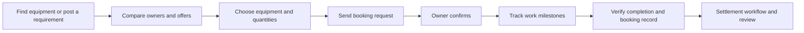

# RigDesk: Heavy-Equipment Rental and Booking Marketplace

### Direct machinery booking, transparent comparison, and a clearer path from job request to payment.

RigDesk is a working marketplace prototype connecting customers who need heavy equipment with equipment owners who need consistent work. It brings discovery, price comparison, reverse auctions, booking, job milestones, booking documents, and settlement status into one experience.

Built for construction, agriculture, borewell drilling, logistics, and infrastructure projects, RigDesk demonstrates how equipment rental can move from scattered phone calls to a direct, trackable digital workflow.

> **RigDesk removes the broker, not the trust.**
>
> Customers save. Equipment works. Owners get paid faster.

**[Visit RigDesk](https://rigdesk-marketplace-rig-desk.vercel.app/)** | **[Choose a demo profile](https://rigdesk-marketplace-rig-desk.vercel.app/demo)** | **[Account access](https://rigdesk-marketplace-rig-desk.vercel.app/sign-in)**

**Source repository:** [siddarthabm123/sidduproject](https://github.com/siddarthabm123/sidduproject)


## 1. Live Website and Demo Access

The web prototype is deployed on **Vercel**. Start with the demo selector to explore a preloaded workspace without OTP.

| Page | Live link |
| --- | --- |
| Official website | [RigDesk Marketplace](https://rigdesk-marketplace-rig-desk.vercel.app/) |
| Demo profile selection | [Choose Customer or Equipment Owner](https://rigdesk-marketplace-rig-desk.vercel.app/demo) |
| Create account / login | [Account Access](https://rigdesk-marketplace-rig-desk.vercel.app/sign-in) |
| Customer equipment search | [Find Equipment](https://rigdesk-marketplace-rig-desk.vercel.app/customer/machinery) |
| Customer equipment map | [Equipment Radar](https://rigdesk-marketplace-rig-desk.vercel.app/customer/radar) |
| Project bidding | [Reverse Auctions](https://rigdesk-marketplace-rig-desk.vercel.app/customer/auctions) |
| Customer bookings | [My Bookings](https://rigdesk-marketplace-rig-desk.vercel.app/customer/bookings) |
| Owner fleet management | [My Fleet](https://rigdesk-marketplace-rig-desk.vercel.app/owner/fleet) |
| Owner requests and bids | [Jobs and Bids](https://rigdesk-marketplace-rig-desk.vercel.app/owner/jobs) |

Workspace links require the corresponding customer or owner session. Select **Siddartha** or **Mahesh** on the demo page first.

### Contents

- [The problem and the idea](#2-the-problem-and-the-idea)
- [How RigDesk works](#3-how-rigdesk-works)
- [Features and their purpose](#4-features-and-their-purpose)
- [Explore the demo](#5-explore-the-demo)
- [Technology](#6-technology)
- [Folder structure and source guide](#7-folder-structure-and-source-guide)
- [Local setup](#8-run-locally)
- [Revenue model](#9-revenue-model)
- [Implementation status](#10-current-implementation-status)
- [Next product milestones](#11-next-product-milestones)

## 2. The Problem and the Idea

Heavy-machinery rental often depends on brokers, repeated phone calls, offline negotiations, and separate owner networks. Customers struggle to compare suitable equipment, understand the full price, or find enough machines for a bulk project. Owners face idle machines, inconsistent enquiries, and uncertainty about payment after completing work.

RigDesk connects these two needs directly and keeps a clear transaction record. Customers can choose equipment by suitability, price, owner reputation, capacity, and location. Owners can publish availability, receive requests, agree on work, and follow it through completion and settlement.

The intended benefits are lower intermediary cost and clearer choice for customers, better machine utilisation for owners, and more predictable settlement. These are product objectives; the prototype does not establish measured savings or guaranteed payment times.

## 3. How RigDesk Works



### For Customers

1. Find equipment by category, location, and work requirement.
2. Compare rates, reviews, ratings, availability, and owner capacity.
3. Choose the number of units and allocate quantities across owners when needed.
4. Enter the date, duration or drilling depth, site address, GPS pin, and instructions.
5. Send a booking request or compare bids in a reverse auction.
6. Follow job milestones, view the booking bond, and review completed work.

### For Equipment Owners

1. Maintain equipment listings, rates, and fleet availability.
2. Review customer requests and project opportunities.
3. Submit bids or accept a suitable booking.
4. Track mobilisation, arrival, work progress, and completion.
5. Follow earnings and settlement status in the workspace.

## 4. Features and Their Purpose

| Capability | Purpose |
| --- | --- |
| Equipment discovery and site maps | Find machines around the work location. |
| Owner comparison | Compare price, rating, reviews, distance, and capacity. |
| Reverse auctions | Let owners compete on a clear project or route price. |
| Multiple equipment units | Allocate bulk requirements by owner and available quantity. |
| Borewell planning | Estimate drilling and casing costs from depth and specifications. |
| Booking milestones | Show request, confirmation, mobilisation, arrival, progress, and completion. |
| PDF bonds with QR verification | Scan a document and compare its signed booking details. |
| Contact and call controls | Support communication after confirmation and record call requests with consent. |
| Wallet and settlement views | Demonstrate reserve amounts, cancellation rules, earnings, and payment status. |
| Language and theme options | Offer English, Hindi, Kannada, light, and dark preferences. |

Equipment examples include excavators, tippers, borewell rigs, tractors, tractor trailers, motor graders, and skid-steer loaders. Sample auctions cover agriculture, construction, and logistics work.

## 5. Explore the Demo

Open the **[demo selection page](https://rigdesk-marketplace-rig-desk.vercel.app/demo)** and choose:

| Profile | What to explore |
| --- | --- |
| **Siddartha: customer / contractor** | Equipment search, radar, owner selection, auctions, bookings, and bonds. |
| **Mahesh: equipment owner** | Fleet listings, incoming work, bids, accepted jobs, and earnings views. |

Both demos open without a password or OTP. Customer and owner demos share booking and auction activity on the same browser; returning to a demo preserves those records. Demo owners, reviews, bids, equipment, and financial values illustrate the product, not confirmed real-world inventory or transactions. Demo activity is not uploaded to real customer accounts.

## 6. Technology

- **Frontend:** React, TypeScript, Vite, Tailwind CSS, Wouter, Lucide icons.
- **Maps:** Leaflet / OpenStreetMap, with optional Google Maps.
- **Data and authentication:** Supabase client integration and SQL scripts.
- **Documents:** PDF generation, QR codes, and server-side HMAC signing.
- **Optional services:** Google Places discovery and Gemini recommendations.
- **Hosting:** Vercel frontend and serverless API functions.

## 7. Folder Structure and Source Guide

The main application and serverless entry points are arranged as follows. This tree highlights the files relevant to running and understanding RigDesk.

```text
RigDesk/
|-- README.md                 # Project overview and setup guide
|-- App.tsx                   # Pages, demo profiles, and marketplace workflows
|-- main.tsx                  # React application entry point
|-- index.html                # Web document shell
|-- index.css                 # Layout, typography, themes, and responsive styles
|-- supabase.ts               # Optional database/auth client configuration
|-- riglogix-data.ts          # Profile, booking, wallet, and persistence helpers
|-- bond-pdf.ts               # PDF booking-bond generation
|-- bond-signature.ts         # Signed QR verification records
|-- api/
|   |-- generate-bond.ts      # Bond PDF endpoint
|   |-- verify-bond.ts        # Signed record verification endpoint
|   |-- discover-providers.ts # Optional Google Places discovery
|   '-- recommend-vehicles.ts # Optional Gemini recommendations
|-- supabase/
|   '-- migrations/          # Additional schema changes and demo seed data
|-- public/
|   '-- assets/              # Machinery images and visual assets
|-- package.json             # Dependencies and runnable scripts
|-- pnpm-workspace.yaml      # Workspace catalog configuration
|-- pnpm-lock.yaml           # Dependency lockfile
|-- tsconfig.json            # TypeScript project configuration
|-- vite.config.ts           # Development server and production build
'-- vercel.json              # Deployment output and route configuration
```

| Location | Responsibility |
| --- | --- |
| `App.tsx` | Landing page, demo selection, accounts, dashboards, equipment, auctions, bookings, and preferences. |
| `RealWorkspace.tsx`, `marketplace.css` | Authenticated customer and owner pages using shared database records, with localized labels and theme support. |
| `marketplace-domain.ts` | Amount, unit-count, ETA, and payment validation. |
| `interface-translations.ts` | Additional English, Hindi, and Kannada interface translations. |
| `index.css` | Styling, themes, and responsive layouts. |
| `supabase.ts` | Optional Supabase client. |
| `riglogix-data.ts` | Authentication, profiles, bookings, wallet helpers, and account-state persistence. |
| `api/` | Bond services, provider discovery, and recommendations. |
| `bond-pdf.ts`, `bond-signature.ts` | PDF generation and signed verification records. |
| `supabase/migrations/` | Additional database migrations and demo seed data. |
| `public/assets/` | Equipment images and other visual assets. |
| `vercel.json` | Hosting build output and route configuration. |
| `tests/` | Regression tests, including isolated PostgreSQL ownership and booking workflow tests. |

Some internal filenames and storage keys retain the earlier RigLogix name. The public project name is **RigDesk**.

## 8. Run Locally

### Prerequisites

- Node.js 22.13 or later (CI uses Node.js 22).
- pnpm 11.19.0; the project uses pnpm workspace catalog dependencies.

Run these commands from the project root.

```sh
git clone https://github.com/siddarthabm123/sidduproject.git
cd sidduproject
```

The current RigDesk application runs from the repository root. The existing `RigLogix-runnable/` and `RigLogix-source-code/` directories contain earlier versions preserved for reference.

### Step 1: Install Dependencies

```sh
pnpm install
```

### Step 2: Start the Frontend

```sh
pnpm run dev
```

The default frontend URL is `http://localhost:5173`. The server uses a strict port; stop an existing server or set `PORT` to another available port.

### Step 3: Build and Preview

```sh
pnpm run build
pnpm run preview
```

### Step 4: Check TypeScript and Regression Tests

```sh
pnpm run typecheck
pnpm run test
```

Tests cover ownership isolation, capacity limits, server-calculated totals, blocked fake wallet credits, customer-confirmed completion, bid validation, repeated awards, document tampering, and demo/live separation. They run in an isolated PostgreSQL instance and do not write to the live Supabase project.

For an optional PDF scan check, run `node --import tsx tests/render-bond.ts`, render the resulting `tmp/pdfs/rigdesk-bond-qa.pdf` with `pdftoppm -png -scale-to 1800 -singlefile tmp/pdfs/rigdesk-bond-qa.pdf tmp/pdfs/rigdesk-bond-qa`, then run `tests/check-rendered-qr.ts` with `RIGDESK_QA_IMAGE_MODULES` pointing to a local Node modules directory containing `sharp`. This checks the QR decoded from the rendered page, not just the encoded URL.

Production output is `dist/public`. The development-only Vite API plugin serves bond and optional provider endpoints locally. It creates a temporary signing key when none is configured; locally generated documents stop verifying after a server restart unless a persistent key is supplied. Production requires its own private signing key.

### Environment Configuration

Use `.env.example` as the template for an untracked `.env.local`. These integrations are optional for a sample-data demo:

```env
VITE_ENABLE_SUPABASE=false
VITE_SUPABASE_URL=
VITE_SUPABASE_ANON_KEY=
VITE_ENABLE_EMAIL_OTP=false
VITE_ENABLE_GOOGLE_MAPS=false
VITE_GOOGLE_MAPS_API_KEY=
VITE_RIGDESK_CALL_NUMBER=
```

Serverless functions use server-side configuration:

```env
BOND_PDF_SECRET=
GOOGLE_PLACES_API_KEY=
GEMINI_API_KEY=
GEMINI_MODEL=gemini-2.5-flash
```

Set a strong private signing secret before generating signed bonds. Variables prefixed with `VITE_` are included in the browser build. Keep service-role keys, server API keys, and signing secrets server-side. Restrict browser Maps keys to the intended domains and APIs.

### Supabase Setup

Set the Supabase URL, public anon key, and `VITE_ENABLE_SUPABASE=true`. Core database scripts are at the repository root, including `20260920000100_riglogix_core.sql` and `20260920000200_riglogix_rls.sql`. Later migrations in `supabase/migrations/` cover demo data, Aadhaar references, and account-state storage.

Review dependencies and apply applicable scripts in chronological order to the target database. Applying only the later migrations to an empty project is insufficient.

Real signup and password login always use Supabase Auth. Disabling the frontend OTP option does not bypass server-side email confirmation. If Supabase requires email confirmation but SMTP is unavailable, use the open demo for a pitch; the application does not falsely claim an email was sent or verified.

The secure workspace requires `supabase/migrations/20261008000900_secure_marketplace.sql`, after the core, RLS, auth workflow, financial-lock, Aadhaar-reference, and user-app-state scripts. Back up the database and inspect its existing schema before applying migrations. Do not apply sample seeds to real user accounts. Deploy the new frontend only after the required migration succeeds.

This migration adds shared equipment-unit bookings, auction and bid tables, atomic theme/language preferences, customer-confirmed completion, and database-issued bond summaries. It restricts direct financial writes, role changes, and owner self-verification. It does not delete existing records or credit wallets. Funded legacy bookings require support review rather than an automated refund.

Equipment created by an owner remains unverified until a trusted database administrator reviews it. The current capacity check reserves units for the selected calendar date, not overlapping multi-day periods. Rates use each listing's billing unit; the booking modal displays the selected quantities and estimated fee. Auction awards request one unit at the agreed project price. A zero-coordinate auction record is not a confirmed GPS location.

### Deploy on Vercel

The included `vercel.json` builds with `npm run build`, serves `dist/public`, and supports client-side routes. Configure environment variables in your Vercel project and deploy through its CLI or connected GitHub repository.

### Updating Source and Documentation

Keep `README.md` current when features, routes, configuration, or setup instructions change. Review the changes and include documentation in the same commit as the corresponding source update.

```sh
git status
git diff
git add README.md <changed-source-files>
git commit -m "Describe the source and documentation update"
git push origin main
```

The GitHub workflow runs TypeScript checks, regression tests, and a production build on `main` and pull requests. Local edits reach GitHub after they are committed and pushed. Supabase migrations are not applied automatically by this workflow.

## 9. Revenue Model

The prototype includes a platform-fee calculation in booking estimates. A production business could use the following model:

| Revenue stream | Method |
| --- | --- |
| Booking service fee | A disclosed fee for facilitating an equipment transaction. |
| Owner subscription | Optional fleet management, analytics, and operating tools. |
| Bulk-project coordination | Fees for managing multi-machine requirements and longer projects. |
| Promoted listings | Clearly labelled paid visibility for owners. |

Subscriptions, promoted listings, and paid coordination are proposed extensions. No proven revenue, traction, or fixed commission rate is claimed.

## 10. Current Implementation Status

The existing public website is deployed on Vercel. Source changes and the required database migration must be deployed separately; a local test result does not establish that the live site has been upgraded. The demo uses browser storage and sample records, while the authenticated workspace uses shared Supabase records.

| Area | Current behavior and dependency |
| --- | --- |
| Registration and login | Real accounts require successful Supabase authentication and a database profile. SMTP and email-confirmation settings still govern account activation. Open demos remain available without OTP. |
| Saved activity | Real bookings, inventory, bids, reviews, and account preferences use the database. Booking parties see shared records, with periodic refresh. Fresh accounts do not inherit sample bookings or balances. Demo activity stays in the browser. |
| Booking security | Server functions calculate prices, check capacity and ownership, prevent repeated awards, restrict milestones, and require the customer to confirm completion. Direct client financial writes and self-verification are blocked. |
| Payments | Wallet and settlement screens demonstrate the workflow. Real UPI transfers, escrow, and bank payouts need a payment-provider integration. |
| Nearby providers | Google Places requires server configuration and authentication. A Maps listing does not confirm machine availability or verify a provider as a RigDesk owner. New authenticated pages currently use registered database inventory. |
| Recommendations | The Gemini endpoint requires authentication and a server API key. Recommendations do not independently confirm live inventory. Configure quotas and abuse controls before enabling paid external services. |
| Calling | The interface logs a consented request and can open a configured company number. Automated forwarding and audio recording require telephony integration. |
| Aadhaar | The form checks format and checksum; it does not authenticate identity against UIDAI. Profile integration uses the final four digits. |
| Bond verification | One-page PDFs place a scannable QR at the top. Live documents require an authenticated booking party and use database totals and dates. Public verification checks the signature, paper reference, and current accepted-booking status. Cancelled records are rejected. Contacts and exact site details are excluded from the public live summary. Demo documents explicitly are not authentic booking proof. Regenerate old v1 bonds, which are no longer accepted. |
| Translation and themes | English is the default; Hindi/Kannada labels and light/dark preferences persist across entry and workspace pages. User-entered business names and job descriptions are not automatically translated. Language quality and mobile layouts still warrant user acceptance testing. |

## 11. Next Product Milestones

1. Apply the tested migration to the live project and validate two real accounts across devices.
2. Add an administrator verification interface and interval-based equipment scheduling.
3. Expand translation and mobile acceptance testing with Kannada/Hindi speakers.
4. Integrate real payment collection and settlement.
5. Connect business telephony for masked forwarding and consented recording.
6. Complete translation, accessibility, and mobile workflow validation.
